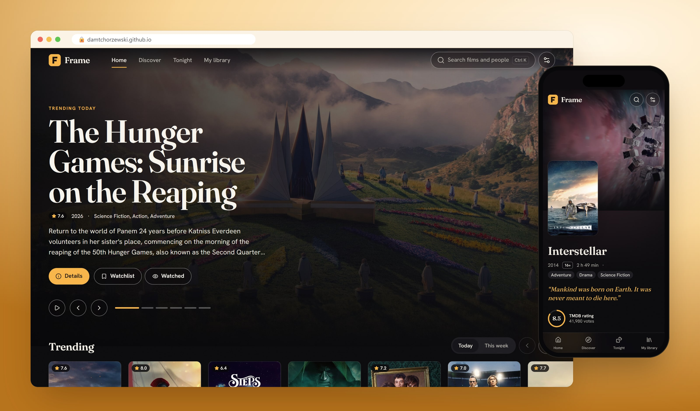
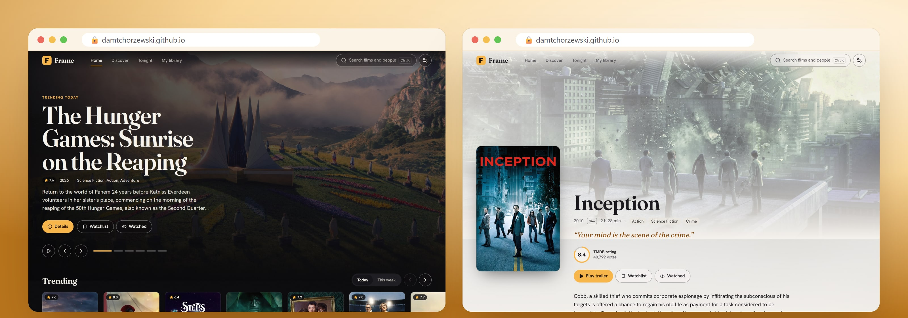
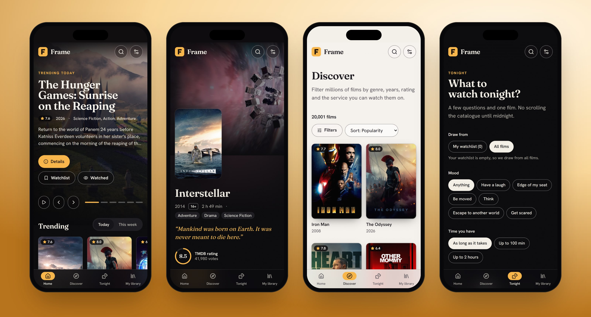

<p align="center">
  <picture>
    <source media="(prefers-color-scheme: dark)" srcset="docs/images/banner-dark.png">
    
  </picture>
</p>

<p align="center">
  
</p>

## About

<a href="https://damtchorzewski.github.io/movie-discovery/"></a>

**Frame** helps you find a film, see where to watch it in Poland and decide what to watch
tonight. It grew out of [Filmoteka](https://github.com/DamTchorzewski/tmdb-movie-browser), a team project of HiFiveTeam,
and is rebuilt from scratch as a single-page app with React and TypeScript.

- **Home.** A trending hero (it advances by itself only without reduced motion, and has a pause button), rows of trends
  for today or the week, films in Polish cinemas, coming soon, top rated and popular on Netflix, HBO Max and Disney+.
- **Search.** A palette on `Ctrl K` or `/` for films and people as you type, and a full results page (`/search/?q=`).
- **Discover.** Genres, release years, minimum rating and votes, runtime, original language and the streaming services
  available in Poland, with six sorts; every filter is in the URL (`/discover/?genres=18&from=2000`).
- **Film page.** Backdrop with an ambient glow, the Polish age rating, the trailer (YouTube loads only after a click),
  cast, director and writers, **where to watch in Poland** (stream, rent, buy; data from JustWatch), the saga, stills,
  facts and recommendations. The clicked poster morphs into the page (View Transitions).
- **People and collections.** Biography, known for and the filmography by role; a saga in order with your progress.
- **My films.** A watchlist and a watched list with your rating (1-10), a note and the date; stats (films, hours, average
  rating, favourite genre); export to and import from a JSON file. The lists of the first Filmoteka are moved over.
- **Tonight.** Pick a mood, the time you have, your services and a minimum rating; Frame shuffles the posters and draws
  one film, from your watchlist or from all films.
- **Polish and English.** Polish at `/`, English at `/en/`, the same page in the other language one click away.
- **Dark, light or system theme**, installable as an app (manifest and an app-shell service worker).
- **Accessible.** WCAG 2.2 AA in both themes, tested with axe on every page template; keyboard and screen reader
  friendly dialogs; `prefers-reduced-motion` respected.

> **Status:** version 1 of Frame is built; the live site waits for the TMDB key as a repository variable
> ([docs/deployment.md](docs/deployment.md)), so the Open site button works after the first deploy of `main`.

## Tech stack

|         |                                                                                                                       |
| ------- | --------------------------------------------------------------------------------------------------------------------- |
| Stack   | [Vite 8](https://vite.dev), React 19, TypeScript 6, TanStack Router (typed routes, `{-$lang}` prefix)                 |
| UI      | Tailwind CSS v4 (`oklch` tokens with `light-dark()`), Motion, lucide icons, Fraunces and Hanken Grotesk (self-hosted) |
| Data    | [TMDB API](https://developer.themoviedb.org/) v3 through TanStack Query; the library in localStorage                  |
| Tests   | Vitest (logic), Playwright on desktop and a Pixel 7 with axe-core (WCAG 2.2 AA, both themes)                          |
| Hosting | GitHub Pages, published by GitHub Actions (`.github/workflows/deploy.yml`)                                            |

The interface is in Polish and English; code, commits and documentation are in English.

Third-party code at run time: the TMDB API and images (`api.themoviedb.org`, `image.tmdb.org`) and, only after a click on
"Play trailer", the YouTube player in privacy-enhanced mode (`www.youtube-nocookie.com`). No analytics, no cookies.

## Screenshots

<p align="center">
  
</p>

<p align="center">
  
</p>

The screenshots are a local build with TMDB's public catalogue; no library was filled and no account was used.

## Quick start

```bash
git clone https://github.com/DamTchorzewski/movie-discovery.git
cd movie-discovery
pnpm install
cp .env.example .env.local   # then fill in VITE_TMDB_API_KEY
pnpm dev                     # http://localhost:5173/movie-discovery/
```

Requirements: Node.js 22 (`.nvmrc`) and pnpm 11.18 (`packageManager`).

## Scripts

| Command                        | What it does                                                                     |
| ------------------------------ | -------------------------------------------------------------------------------- |
| `pnpm dev`                     | development server with hot reload                                               |
| `pnpm build`                   | typecheck and production build to `dist/` (with the CSP and the Pages fallbacks) |
| `pnpm preview`                 | serve the build on port 4173                                                     |
| `pnpm check`                   | `format:check`, `lint`, `typecheck` and `test`                                   |
| `pnpm test`                    | unit tests (Vitest)                                                              |
| `pnpm test:e2e`                | Playwright end-to-end, axe and reduced-motion tests (builds with a fake key)     |
| `pnpm e2e:install`             | install the Chromium that Playwright uses                                        |
| `pnpm health`                  | read-only check of the live site (`SITE_URL=...`)                                |
| `pnpm format`, `pnpm lint:fix` | fix formatting and lint problems                                                 |
| `node scripts/brand.mjs`       | regenerate the favicon, the icons, `og.png` and the lockups from the mark        |

## Configuration

Copy `.env.example` to `.env.local` (git-ignored):

| Variable            | What                                                                                           |
| ------------------- | ---------------------------------------------------------------------------------------------- |
| `VITE_TMDB_API_KEY` | TMDB API key (v3); ships to the browser on purpose; without it the app says the key is missing |
| `SITE_URL`          | optional public address with its path; the default base path is `/movie-discovery/`            |

Where each value is set on GitHub and why the key is a variable: [docs/deployment.md](docs/deployment.md).

## Structure

```
src/main.tsx, router.tsx     entry, TanStack Query and the routes (Polish at /, English at /en/)
src/i18n/messages.ts         ★ every interface text in Polish and English
src/lib/                     TMDB client and queries, Discover filters, library store and schema, tonight picker
src/components/              app shell, search palette, hero, rails, poster and person cards, dialogs, states
src/components/illustrations/ line illustrations for the empty states (reel, ticket, search, cut, key)
src/brand/mark.ts            ★ the mark: the one drawing the logo, the favicon and the icons come from
src/pages/                   one file per page: home, discover, search, film, person, collection, my films, tonight, about
src/styles/app.css           ★ design tokens (both themes), components, motion
src/assets/team/             photos of HiFiveTeam for the About page
public/                      favicon, manifest, icons, social image, service worker
brand/                       lockups of the mark and the wordmark for dark and light backgrounds (SVG, PNG)
tests/e2e/                   Playwright specs, helpers and the TMDB fixtures
scripts/health.mjs           live-site check run after a deploy
scripts/brand.mjs            writes the favicon, icons, social image and lockups from src/brand/mark.ts
docs/                        brand and design, deployment, decisions, repository settings
.github/workflows/           ci.yml (pull requests), deploy.yml (develop build, main deploy)
```

## Branches and workflows

Shared standards from `reops/standards`: `main` ≤ `develop` ≤ a working branch `<type>/<topic>`, Conventional Commits
in English, a work PR into `develop` and a release PR into `main`. CI runs on every pull request; `main` deploys. Details:
`reops/standards/git.md` and `reops/standards/workflows.md`.

**Departures from the standards (and why):**

- **A service worker** although client sites have none: Frame is an installable app; it caches only the app shell and
  keeps HTML network first ([docs/decisions.md](docs/decisions.md)).
- **A public API key in the bundle:** a static site has no server and TMDB cannot restrict a key to a domain; it is a
  repository variable, never committed ([docs/decisions.md](docs/decisions.md)).
- **The CSP is a `<meta>`, the other security headers are missing:** GitHub Pages cannot send headers; the meta CSP
  carries the hash of the one inline script.

## Documentation

| File                                     | What it covers                                                                        |
| ---------------------------------------- | ------------------------------------------------------------------------------------- |
| [docs/design.md](docs/design.md)         | the brand: name, mark, palette, type, usage, the generated files                      |
| [docs/deployment.md](docs/deployment.md) | workflows, variables, Pages paths, CSP, health check, rollback                        |
| [docs/decisions.md](docs/decisions.md)   | why a new repository, a SPA, the key in the browser, localStorage, the service worker |
| [docs/repository.md](docs/repository.md) | GitHub description, topics and settings, and the command that sets them               |

The README images (`docs/images/`) are made with `tools/readme-images`, profile `movie-discovery`, from a local
`pnpm preview`. Local working files (exports, archived images of the first version) live in `.scratch/`, never
committed.

## Versions

| Version                    | Repository                                                                   | Made by                                                                                        |
| -------------------------- | ---------------------------------------------------------------------------- | ---------------------------------------------------------------------------------------------- |
| 1: Filmoteka               | [`tmdb-movie-browser`](https://github.com/DamTchorzewski/tmdb-movie-browser) | HiFiveTeam (see its [Team section](https://github.com/DamTchorzewski/tmdb-movie-browser#team)) |
| 2: Frame (this repository) | `movie-discovery`                                                            | [Damian Tchorzewski](https://github.com/DamTchorzewski)                                        |

This product uses the TMDB API but is not endorsed or certified by TMDB. Streaming availability comes from JustWatch.

Licensed under the [MIT License](LICENSE).

---

<p align="center"><a href="https://damreboot.pl"><picture><source media="(prefers-color-scheme: dark)" srcset="docs/images/damreboot/company-dark.svg"></picture></a><a href="https://www.linkedin.com/in/damian-tchorzewski-3b2388275/"><picture><source media="(prefers-color-scheme: dark)" srcset="docs/images/damreboot/linkedin-dark.svg"></picture></a><a href="mailto:damianchabracki@gmail.com"><picture><source media="(prefers-color-scheme: dark)" srcset="docs/images/damreboot/email-dark.svg"></picture></a></p>

<p align="center">
  <picture><source media="(prefers-color-scheme: dark)" srcset="docs/images/damreboot/engineered-dark.svg"></picture> Engineered by <b>Damian Chabracki</b> (DamReboot IT)
</p>
